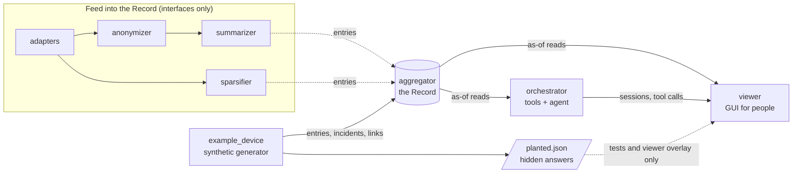

# Operations Orchestra prototype: design and hand-off

Status: 16 November 2026, branch `prototype/synthetic-record`.
Audience: anyone picking this work up, person or coding agent, with no prior context.

> Everything in this repository is synthetic. Real detector names, no real events.
> See [the rule](#7-rules-for-contributors).

## 1. What this is

The Operations Orchestra is a pipeline that turns a facility's scattered operations
records (control-system readings, data-quality summaries, logbooks, certification) into
one linked, queryable **Operations Record**, and an agent that uses the Record to help a
shift crew diagnose a problem.

This repository is a prototype of that idea on a **synthetic, HCAL-like example device**.
Its goal is a runnable demonstration of one story: a problem happens, an expert fixes it,
the same problem happens again to a different crew, and the agent recalls the first
incident and proposes the fix that was captured, citing the entries it relied on.

It is split into two parts on purpose:

1. **The feed into the Record**: source adapters, anonymizer, summarizer, sparsifier.
   Interfaces only. Real implementations need access to real records.
2. **Everything downstream of a filled Record**: the Record itself, query tools, the
   agent, and tools for people. This part runs, on a Record filled by the synthetic device.

### Where things stand

| Part | Folder | State |
|---|---|---|
| Shared entry definition, time helpers | `utils/` | built, tested |
| The Record: database, write API, as-of read API | `aggregator/` | built, tested |
| Text and plot viewing commands | `aggregator/view.py` | built, tested |
| Synthetic device generator | `example_device/` | built, tested |
| GUI to understand and check the components | `viewer/` | built and remade once; see GUI_PLAN.md section 11 |
| Query tools and diagnosis agent | `orchestrator/` | designed, not built, section 6 |
| Feed interfaces | `adapters/`, `anonymizer/`, `summarizer/`, `sparsifier/` | designed, not built, section 6 |

The synthetic data has **not yet been reviewed by a detector expert**. That review is the
reason the GUI comes before the agent.

## 2. Words used here

| Word | Meaning |
|---|---|
| **Record** | The linked database. One SQLite file, `out/record.db`. |
| **Entry** | One row of the Record: a reading summary, an event, a logbook note, a flag. All entries share one envelope (`utils/entry.py`). |
| **Element** | A part of the device an entry is about: a readout box, a channel, a supply, a FED, a subdetector. |
| **Event time** | When the thing happened or held (`t_start`, `t_end`). |
| **Known-at** | When the Record learned of it (`known_at`). A logbook note is known minutes after the event; a root cause may be known weeks later. |
| **As of** | Every read names a moment and returns only what was known by then. |
| **Incident** | A group of entries that people decided belong to one problem, with three separate labels: recovery action, confirmed cause, certification. |
| **Open issue** | An incident that is not closed. Same table, different status. |
| **Direct link** | Two entries share an element or interval. Context, not cause. |
| **Indirect link** | An expert's reasoning: this observation supports that conclusion. |
| **Planted case** | A situation the generator put into the data on purpose, listed in `out/planted.json` with the honest answer. Never part of the Record. |

## 3. How it fits together



Dashed arrows are not built. The synthetic device stands in for the whole feed: it writes
entries straight into the Record through the same write API the feed will use.

### Dependency rule

Folders are named after the repositories of the `operations-orchestra` organization so
each can move out later. `tests/test_boundaries.py` enforces who may import whom:

| Folder | May import |
|---|---|
| `utils` | nothing of ours |
| `aggregator` | `utils` |
| `example_device` | `utils`, `aggregator` |
| `orchestrator` | `utils`, `aggregator` (never `example_device`: the agent must not see the generator) |
| `viewer` | `utils`, `aggregator`, `orchestrator`, and `example_device` only to build a new Record |

SQL appears only in `aggregator/`. Everything else calls typed Python methods on
`RecordStore`, so a move to PostgreSQL is a rewrite of one module.

## 4. What is built

### 4.1 The entry envelope (`utils/entry.py`)

`source`, `record_class` (MS machine state, QA quality, HI human interpretation), `kind`,
`type`, `element`, `t_start`, `t_end`, `known_at`, `payload` (free-form), `raw_ref`
(pointer to source data, never a copy), `producer`, `producer_version`, `review_status`.

`kind` says what the times mean:

| Kind | Meaning | Example |
|---|---|---|
| `state` | holds from `t_start` until the next state of that type on that element | supply on/off |
| `point` | happened at `t_start` | run stop, FED out of sync |
| `report` | a statement about an interval, by a person or procedure | logbook note, certification flag |
| `feature` | a summary of bulk data over a window | 15-minute voltage mean, min, max, slope |

### 4.2 The Record (`aggregator/schema.sql`, `aggregator/store.py`)

Eight tables: `element`, `element_relation` (service-side links such as "box powered by
supply"), `entry`, `link`, `incident`, `incident_entry`, `query_log`, `meta`.

Properties that matter:

- **Append-only.** A correction is a new entry that names the one it supersedes; reads
  hide the old one from the correction's known-at time on. Incident labels are write-once.
- **Every read takes `as_of`.** This covers entries, links (both ends must be known),
  incidents, and each incident label separately. An incident's status is derived:
  `open`, then `mitigated` once a recovery is known, then `closed` or `unresolved`.
- **State lookback.** `state_at(element, type, t, as_of)` returns the last change at or
  before `t`, however old. A window query would miss it and wrongly conclude "all fine".
- **Opened read-only** by default.

### 4.3 The synthetic device (`example_device/`)

Work order: fit settings to the size budget, plan the calendar and fault placement
(`plan.py`), write routine background already shaped by the planned faults, write what
each fault adds, then write `planted.json`.

- Device: `CMS > HCAL > subdetector > readout box > channel`, plus supplies and FEDs.
- Calendar: starts 2040-03-01; fills of 8 to 11 hours; one technical stop; runs start at
  900001, fills at 50001; lumisections of 23 seconds.
- Background: voltage and temperature summaries per box, supply and control-link states,
  beam mode, configure attempts, run start/stop, per-run occupancy summaries,
  certification flags (known 1 to 3 days later), shift notes, daily summaries.
- Sizes: `tiny` 0.9 MB, `small` 9.5 MB, `full` up to 100 MB. Over-budget requests are
  coarsened, then shortened, then refused. Same seed, same Record (checked by hash).

Planted situations, and when each piece of knowledge reaches the Record:

| Mode | Symptom | Recovery known | Cause known |
|---|---|---|---|
| `configure_failure` | HCAL fails to configure on the first two fills after the stop; the crew sees only "HCAL in error". The clue is a control-link state that went bad hours earlier. | 6 hours after the fix | 6 days later |
| `fed_comm_loss` | a FED goes out of sync, run stops | at once (reconfigure) | 4 days after the *second* occurrence; never if it does not recur |
| `lv_drift_trip` | supply voltage sags 0.35 V over 6 hours, then trips | at once (power cycle) | 14 days later |
| `hot_channels` | no downtime; hot fraction in the quality summary; data certified bad | next expert slot (15:00 UTC) | 5 days later, or never (30%) |
| `box_sync_loss` | data integrity errors, run stops | at once (reset) | never |
| `planned_change` | occupancy rises after an announced threshold change | not an incident | not an incident |

### 4.4 Commands

```
orchestra synth [--preset tiny|small|full] [--seed N] [--max-size-mb N] [--out DIR] [--force]
orchestra info  [--db FILE] [--as-of TIME]
orchestra show  INCIDENT_ID [--as-of TIME]
orchestra plot  ELEMENT [--from TIME] [--to TIME] [--as-of TIME] [--out FILE]
orchestra view  [--db FILE] [--port N]
```

### 4.5 Tests (74 pass, 1 skipped until `orchestrator/` exists)

| File | Checks |
|---|---|
| `test_generator.py` | determinism, size budget and refusals, no-real-events guard, roles not names, every planted fault present, the configure-failure pair, the voltage sag |
| `test_store.py` | round trip, validation, corrections add a version, write-once labels, derived status, no overwrite, read-only open |
| `test_as_of.py` | no entry, label or link from the future; state lookback |
| `test_boundaries.py` | import rule, SQL only in the aggregator |
| `test_view.py` | viewing commands run and respect as-of |
| `test_viewer.py` | the GUI service: as-of required, nothing from the future, read-only, serves the page |

### 4.6 Known weak points

- The voltage sag is hard to see in the static plot because the trip to 0 V sets the scale.
- In `tiny`, hot channels and a supply trip overlap on the same box by chance of the seed.
- The size estimate is cautious: `small` widens its windows to one hour before it must.
- Logbook text comes from a few templates per situation, so finding a precedent is far
  easier than on real logbooks. Marked "to be revisited".
- `planted.json` counts any earlier incident of the same mode as a precedent, even on a
  different element. See open question 2.

## 5. The GUI, and what comes next

The prototype can currently be inspected only through terminal commands and static plots.
Before more is built, people need to see inside each component and operate it by hand,
and a detector expert needs to judge the synthetic data.

The plan is in [GUI_PLAN.md](GUI_PLAN.md): a local, read-only web page in a new `viewer/`
folder that shows the Record through the real read methods, with one time control on
every page. It covers the device and its fault scripts, the Record, zoomable timelines,
how knowledge about an incident arrived, a side-by-side comparison of the two possible
precedent rules, and, once they exist, the query tools and the agent.

It was remade after review into five ordered pages (detector, how the Record is built,
what is in it, scenarios, replay); GUI_PLAN.md section 11 is the current description. What comes next is the project
lead's review of the synthetic data with it (open questions 1 and 2), then section 6.

## 6. After that: the agent and the feed interfaces

Agreed design, not built.

### 6.1 Query tools (`orchestrator/tools.py`)

Typed, read-only, and the only way the agent touches the Record. No raw SQL tool.

| Tool | Returns |
|---|---|
| `state(element, t)` | the state of each type on the element at `t`, with lookback |
| `events(window, scope)` | entries in a time window on an element and its surroundings |
| `co_occurring(event, window)` | what else happened near an entry, in time and in structure |
| `search_incidents(text, element)` | past incidents and open issues; always the whole Record, never a window |
| `get_incident(id)` | one incident with its labels and entries |

Every call requires `as_of`, is written to `query_log`, and can be re-run to give the
same entries.

### 6.2 The diagnosis agent (`orchestrator/agent.py`)

Output is a fixed structure, not free text, because open-weight models reason less
reliably:

- affected element
- verdict: `known`, `new`, or `uncertain` (when unsure, say `new`: a false "known" misleads the crew)
- diagnosis
- supporting evidence and conflicting evidence: entry IDs, each with the query that returned it
- next step: `check`, `recovery procedure`, or `escalate`
- which label it relied on: certification, recovery action, or confirmed cause

The proposal is validated: any cited entry that did not come back from a logged tool call
in that session is rejected as an unsupported claim. The agent proposes; a person decides.

Two interchangeable brains behind one interface:

1. **Scripted**: search past incidents on the element with similar symptoms; read the
   element's state; list what else happened nearby; fill in the structure. No model, no
   network, same answer every time. Used by tests and for a demo that always works.
2. **Model**: any endpoint that speaks the OpenAI-compatible chat-completions tool-calling
   protocol, set by base URL and model name, so the same code runs on a local open-weight
   model or a hosted one. Tested against a fake server only until an endpoint is chosen.

Commands: `orchestra ask "..." --as-of TIME` and `orchestra demo`, which prints three
cases: a new problem that is escalated; a recurrence recalled with its fix; a precedent
found before its fix was recorded.

### 6.3 Interfaces of the unbuilt parts (written 17 November 2026)

Each unbuilt part exists as code that fixes its interface, with every method raising
`NotImplementedError`: `adapters/base.py` (the `SourceAdapter` contract, `RawRecord`, and five
adapters to write), `anonymizer/`, `summarizer/`, `sparsifier/`, `aggregator/linker.py`
(direct links), `orchestrator/tools.py` and `orchestrator/agent.py`. Each module also declares
`STATUS`, `ROLE` and an `EXAMPLE` of what it takes and gives. The GUI page "Interfaces of
unbuilt parts" is read from these files, and a test checks that every method of a skeleton
still refuses to run. The detector model has no interface file yet; see DETECTOR_PLAN.md.

### 6.4 Deliberately left out

Benchmark harness and baselines, a replay engine, the expert review interface that writes
verdicts, raw-format device records, plot images, database write roles.

The natural step after this prototype is to have the device emit **raw-format records**
(logbook text with names, control-system CSVs), because that is what would turn the feed
interfaces into running code.

## 7. Rules for contributors

1. **Real names, never real events.** Detector naming may follow public CMS naming.
   No real incidents, run or fill numbers, timestamps, host names or logbook text, and
   nothing copied from real downtime or certification files. The generator and a test
   enforce the invented ranges.
2. **Synthetic results are not evidence of diagnostic ability.** The person who writes the
   faults also writes the agent that finds them. A pass here shows that the plumbing works
   and nothing leaks. Say so wherever results are shown.
3. **No read without `as_of`.** New read methods and endpoints take it as a required argument.
4. **SQL stays in `aggregator/`.**
5. **The agent never imports the generator**, and never reads `planted.json`.
6. **Append, do not overwrite.** Corrections supersede.
7. **Generated files are not committed.** `out/`, `*.db`, `*.png`, `planted.json` are ignored.
8. **This is a shared repository.** Work on the branch; push or open a pull request only
   with the project lead's agreement.

## 7a. Design notes from review

**Time series: decided 17 November 2026.** The Record stores no time series. It records a
reading only when its status changes (normal, drifting, low, high, off), with a pointer into
the source; the series stays in the source and is fetched at full resolution on demand.
This joins the earlier decision that facts stay in their sources (`nsf-ai-datasets/CLAUDE.md`)
with the proposal's "compact features and pointers". In the demo the generator writes the
full series to a simulated control-system archive (`out/source/control_archive/`, not the
Record), applies a fixed status rule (`example_device/readings.py`), and the GUI reads the
series through `adapters/control_archive.py`. The `tiny` Record went from 2,569 entries to
289. The text below describes the earlier design and is kept for the record.

**Sparsification is a key design choice, previously hidden in the generator.** A reading is
stored as four numbers per window (mean, minimum, maximum, slope); the window is 15
minutes in `tiny` and is widened automatically when a Record would exceed its size
budget. In production this is the sparsifier's decision. What it costs: anything faster
than a window is lost, the slope inside one window is about as large as the noise, and a
storage limit ends up deciding what the Record can represent. The demo cannot test
whether diagnoses survive the compression, because it has no full-resolution data. The
GUI states this on "How the Record is built". A working sparsifier fed by a raw series was
discussed and deferred.

**Data-quality plots.** The demo has none: one row of five numbers per run and box.
Direction from the project lead: the Record should keep the plots relevant to an
incident, a very small fraction of all plots. Ideally the logbook entry references the
plot and the Record stores a pointer. In practice it will mostly have to be the images
attached to logbook entries. Still open, and hard: who or what decides which plots are
relevant, and whether an image is copied or only pointed to when the source may not keep
it. The schema needs no change: a plot is one more entry attached to the incident.

**The feed is not simulated.** The generator writes entries directly. None of the adapters,
anonymizer, summarizer or sparsifier exists, not even as an interface file, and there is no
raw data for them to consume.

## 7b. To do

| To do | Why | Touches |
|---|---|---|
| ~~**Let an entry or incident name several elements.**~~ **Done 17 November 2026** as `part_ref` (see aggregator/README.md). Add a table "this entry concerns these elements", each with a role such as affected or suspected. | Every entry and incident names exactly one element today. That was a schema shortcut, not a modelling decision: a real root cause often involves several parts (a box and its supply, or two subsystems). | `aggregator/schema.sql` and the read methods; the detector map and timelines (an entry would appear on every part it names); the "same element" precedent rule (becomes "shares an element"); per-subsystem write rules for entries that span subsystems. Expect sizeable GUI changes. |
| **A realistic detector model, by integrating cmscoord.** | The toy detector is one parent per part with hand-made links and no times. Plan written, not started: [DETECTOR_PLAN.md](DETECTOR_PLAN.md). It absorbs the row above (stage B) and maps over time (stage D). | a new `detector/` package; the Record's element tables; the generator; the GUI |
| Entries: more views than the raw table. | Suggested, from low to high level: by type, by element, by run, around a moment, by incident. Awaiting a choice. | `viewer/` only |
| Status rules per quantity, owned by subsystems; the same treatment for data quality. | The demo's rule is hand-picked and lives in the generator; see 7a. | `example_device/readings.py`, later `sparsifier/` |
| Incident plots. | See 7a; the project lead will return to it. | schema unchanged |

## 8. Open questions for the project lead

| # | Question | Blocks |
|---|---|---|
| 1 | Does the synthetic data look plausible: fault signatures, the delays before recovery and cause are written down, the logbook wording? Needs the GUI first. | trust in everything after |
| 2 | What counts as a precedent: the same element, or the same symptom anywhere in HCAL? | `planted.json` expectations, agent verdicts |
| 3 | Is a Build-a-Record control in the GUI wanted at all? | nothing |
| 4 | Should `viewer/` become a seventh repository in the organization, or live in `orchestrator`? | folder layout |
| 5 | Logbook templates were accepted "to be revisited". Revisit before or after the agent? | how convincing recall looks |
| 6 | Which model endpoint for the real-model run? | 6.2, second brain |

## 9. Picking this up

As of this writing the branch exists only in the project lead's local clone; it has not
been pushed. Once it is:

```bash
git clone git@github.com:operations-orchestra/example-device.git
cd example-device && git checkout prototype/synthetic-record
pixi install                      # or: pip install -e '.[plot,dev]' on Python 3.10+
pixi run pytest -q                # 74 pass, 1 skipped
pixi run orchestra synth          # out/record.db, out/planted.json
pixi run orchestra info
pixi run orchestra show 3 --as-of 2040-03-02T12:06
```

Read in this order: this document, `utils/entry.py`, `aggregator/schema.sql`,
`aggregator/store.py` (read API at the bottom half), `example_device/plan.py`, then
`example_device/generator.py`.

Start by running `orchestra view` and reading the pages in their numbered order. The next
building step is section 6, once open questions 1 and 2 are answered.
